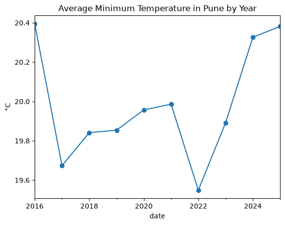
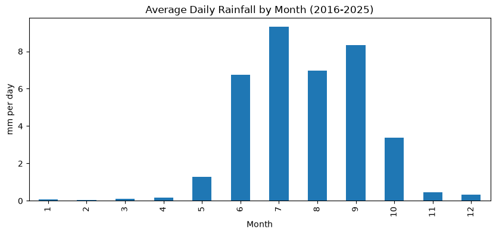

## Methodology

The analysis is in `weather_analysis.ipynb` and follows these steps:

1. **Load and inspect.** Read the CSV with Pandas, skipping the metadata lines. Check the column types with `df.info()` and confirm there are no missing values with `df.isna().sum()`.
2. **Clean.** Rename the columns to short names (`tmax`, `tmin`, `precip`), convert the `time` column to datetime, and set it as the index.
3. **Aggregate by month.** Use `resample("MS")` to compute the monthly mean of the daily maximum and minimum temperatures, and the monthly total rainfall.
4. **Aggregate by year.** Use `resample("YS")` to compute the same summaries for each calendar year.
5. **Seasonal profile.** Group the daily data by calendar month across all ten years to get the average daily rainfall for each month.
6. **Visualize.** Plot the yearly average minimum temperature as a line chart, and the average daily rainfall by month as a bar chart.

## Key Findings

**Temperature**
- March and April are the hottest months, with average daily maximum temperatures around 36–38°C.
- December and January are the coolest months, with average daily minimum temperatures around 16.7°C.
- The yearly average minimum temperature ranged from about 19.5°C to 20.4°C. It dipped in 2017 and 2022 and has recovered since, so there's no clear long-term trend in this ten-year window.

**Rainfall and the monsoon**
- Most rain falls between June and September. Dry months (November to April) receive very little rain.
- July is the wettest month, averaging about 9.3 mm per day across the ten years.
- September has the highest total rainfall of any month, about 424 mm on average.
- Annual rainfall varied widely, from about 681 mm in 2018 to about 1,485 mm in 2020.

## Charts

**Yearly average minimum temperature**

**Average daily rainfall by month (2016–2025)**

## Limitations

- Ten years is a short period. Year-to-year variation is large, so the temperature trend should be treated as inconclusive.
- The data comes from a reanalysis model (ERA5), not direct station measurements. Values are grid-based estimates for the coordinates used and may differ from local observatory readings.
- The analysis uses daily aggregates only and does not examine extreme events, heatwaves, or individual storms.

## How to Run

1. Clone the repository or download the project folder.
2. Install the required packages: pip install pandas numpy matplotlib jupyter
3. Open `weather_analysis.ipynb` in Jupyter or VS Code and run all cells from top to bottom.

## Tools Used

- Python 3.15
- Pandas
- NumPy
- Matplotlib
- VS Code